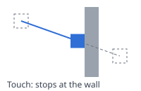
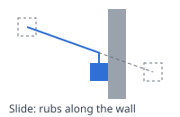
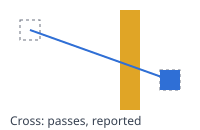

# obstenku

[](https://pkg.go.dev/github.com/shpaker/obstenku)

*Boxes stop at walls. Every time.*

obstenku is collision detection and response for axis-aligned rectangles: tanks,
bullets, bricks, crates, coins. A moving box is swept along its whole path, so it
never slips through a thin wall however far it goes in one tick, and it comes to rest
exactly flush against what it hits. No physics, no dependencies, plain Go.

*obstenku — «об стенку», into the wall: where a bullet ends up.*

## Good fit

- Top-down and grid games: tanks, mazes, shoot 'em ups, roguelikes.
- Platformers with rectangular tiles.
- Games where things move fast and walls are thin.

## Not a fit

- Rotation, circles, slopes and polygons.
- Mass, bounce, friction, joints. Need physics? Take
  [Box2D](https://box2d.org) or [cp](https://github.com/jakecoffman/cp).

## Used in

- [tnk9x](https://github.com/shpaker/tnk9x) — tanks from the 90s the way we remember
  them, with real-time 2D lighting.

## Quick start

```
go get github.com/shpaker/obstenku
```

```go
type item string
world := obstenku.NewWorld[item](16) // cell size: about one item

world.Add("tank", obstenku.Rect{X: 0, Y: 0, W: 16, H: 16})
world.Add("brick", obstenku.Rect{X: 40, Y: 0, W: 4, H: 16})
world.Add("star", obstenku.Rect{X: 20, Y: 4, W: 8, H: 8})

// The game decides how its items meet
filter := func(_, other item) obstenku.Response {
	if other == "star" {
		return obstenku.Cross // picked up on the way
	}
	return obstenku.Slide
}

// However far the tank goes in one tick, it stops at the brick
pos, cols, _ := world.Move("tank", obstenku.Vec2{X: 1000, Y: 0}, filter, nil)
fmt.Println("tank at", pos) // tank at {24 0}
for _, c := range cols {
	fmt.Println("met", c.Other, c.Response) // met star Cross, met brick Slide
}
```

Items are keyed by any comparable value — a pointer to the game's entity works best.
`Check` is `Move` on paper: it tells where the item would end up and leaves the world
as it was.

## Responses

The filter answers, for every item on the way, how the moving one meets it.
Meetings come in the order of the path.

| | |
|---|---|
|  | **Touch** — stop where the boxes touch. A bullet hitting a brick. |
|  | **Slide** — stop along the axis hit, keep moving along the other. A tank rubbing along a wall. |
|  | **Cross** — pass through and be told. A bonus picked up, a trigger zone. |

**Ignore** — the boxes do not meet at all: a tank and the forest above it. A nil
filter slides along everything.

Boxes that only touch with an edge do not collide, so a box rests flush against a
wall and slides along it freely. A box that already overlaps another one — a tank
spawned on top of another — is stopped only when it goes deeper, so it can always get
out.

## Filters

```go
filter := func(mover, other *Entity) obstenku.Response {
	switch {
	case other.Layer != mover.Layer:
		return obstenku.Ignore
	case mover.IsBullet() && other == mover.Owner:
		return obstenku.Ignore // no shooting yourself
	case other.IsBonus():
		return obstenku.Cross
	case mover.IsBullet():
		return obstenku.Touch
	}
	return obstenku.Slide
}
```

## Queries

```go
world.QueryRect(spawnArea, isTank, nil)        // is the spawn point free?
world.QueryPoint(obstenku.Vec2{X: x, Y: y}, isIce, nil)
world.QuerySegment(gun, target, isWall, nil)   // line of fire, nearest first
```

Each takes an optional `keep` filter and appends to a slice you pass in, so a game
can reuse it every tick. Results come in a fixed order: the order of adding for
rectangles and points, the distance along the segment for segments.

## Cell size

The world sorts items into square cells to look only at the ones nearby. The size
changes speed, never results: about the size of a typical item, or the step of the
game's grid, works well.

## With koleya

[koleya](https://github.com/shpaker/koleya) moves along a grid, obstenku stops at walls:

```go
koleya.Step(&m, intent, profile, koleya.Ground, dt)
goal := obstenku.Vec2(m.Pos)
pos, _, _ := world.Move(tank, goal, filter, nil)
if pos != goal { // stopped by a wall
	m.Pos = koleya.Vec2(pos)
	m.Halt()
}
```

## The promise

Whatever the speed, the frame time or the layout of walls, a box never passes through
an item that stops it, and never goes deeper into one it started inside. The result
does not depend on the order the items were added in. Fuzz tests (`just fuzz`) hold
obstenku to it.

## License

[MIT](LICENSE)
